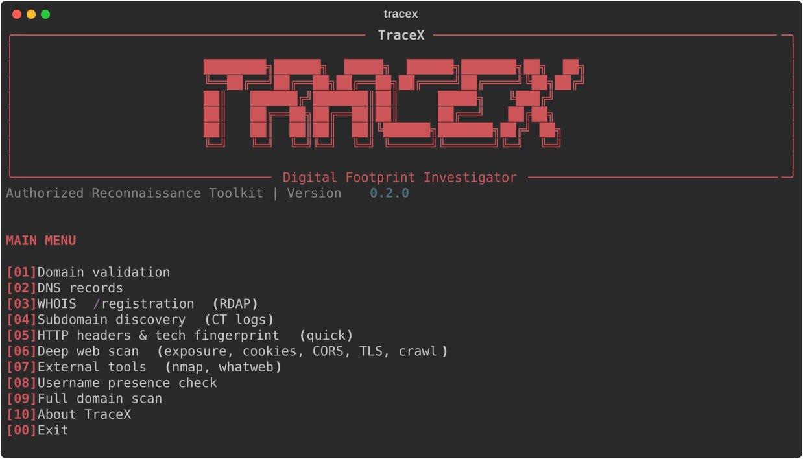
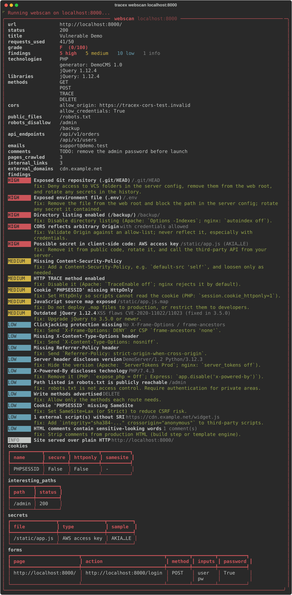

<div align="center">

# TraceX

**Digital Footprint Investigator**

A modular terminal toolkit for authorized security reconnaissance:
DNS, WHOIS, subdomains, a deep web audit, and a graded report with a fix for every finding.

[](https://github.com/r007v1rus/TraceX/actions)




</div>

> **Authorized use only.** Run TraceX only against domains, hosts and accounts you
> own or have explicit written permission to assess. TraceX is read-only: it
> sends ordinary requests (DNS, RDAP, one HTTP GET per path, public profile URLs)
> and never exploits anything, but you are responsible for how you use it.

## Why TraceX

Most recon tools dump raw data. TraceX tells you **what matters and how to fix it**:
every finding has a severity and a concrete remediation, and each scan ends with a
grade and a prioritised "fix first" list.



## Features

| Module | What it does |
|---|---|
| `dns` | A, AAAA, CNAME, MX, NS, TXT, SOA, CAA records **plus email-security checks**: SPF (`+all`, `?all`, multiple records), DMARC (missing, `p=none`), DKIM selectors, CAA, nameserver redundancy |
| `whois` | Registrar, dates, status and nameservers via RDAP. Flags expiring/expired domains, missing transfer lock, recently registered domains, DNSSEC |
| `subdomains` | Passive discovery from Certificate Transparency logs, then resolves each host: live vs dead, **dangling-CNAME takeover detection**, sensitive-looking names (`staging`, `jenkins`, `admin`...) |
| `webscan` | **Deep web audit** (details below) |
| `http` | Quick fingerprint: redirects, server, security headers, technologies |
| `tools` | Runs installed `nmap` (service/version scan) and `whatweb`, and merges the results |
| `username` | Public profile presence on common developer sites |
| `scan` | `dns` + `whois` + `subdomains` + `webscan` in one run, with a combined grade |

Also: interactive menu, `--json` output for pipelines, JSON/Markdown report export,
and a hard request budget so a scan never surprises the target.

### What `webscan` checks

Default budget **50 requests** (`--deep` = 150, `--max-requests N` to set your own).
Sequential, same-origin only.

- **Security headers:** HSTS, CSP, clickjacking, nosniff, Referrer-Policy, version leaks
- **Exposed files (30 paths, 48 with `--deep`):** `.git`, `.env`, backups, SQL dumps, config source leaks, phpinfo, actuator, directory listings, API specs. Hits are content-validated and compared with the site's own 404 page, so single-page apps don't cause false positives
- **JavaScript analysis:** leaked keys and tokens (AWS, Google, Stripe, GitHub, Slack, JWT, private keys; values are masked), API endpoints, exposed source maps
- **Libraries:** detects jQuery / Bootstrap / AngularJS versions and flags known-vulnerable releases
- **robots.txt intelligence:** probes the "hidden" paths to see whether they are actually reachable
- **WordPress extras** (only when WordPress is detected): REST user enumeration, XML-RPC, debug.log
- **Cookies:** Secure / HttpOnly / SameSite
- **CORS** (reflected origin, with or without credentials) and **HTTP methods** (TRACE, PUT, DELETE)
- **TLS:** trust, issuer, expiry, protocol version, HTTP-to-HTTPS redirect
- **Crawl:** forms (password forms over HTTP), external domains, scripts without SRI, mixed content, emails, sensitive HTML comments

### Scoring

Score = 100 minus 15 per high, 5 per medium and 1 per low finding.
Grades: **A** 90+, **B** 80+, **C** 65+, **D** 50+, **F** below. The grade is a triage
aid, not a certification.

## Installation

Python 3.11 or newer.

```bash
# Recommended: isolated install, nothing to activate
pipx install git+https://github.com/r007v1rus/TraceX

# Or from a clone, with a virtual environment
git clone https://github.com/r007v1rus/TraceX
cd TraceX
python -m venv .venv
source .venv/bin/activate          # fish: source .venv/bin/activate.fish
pip install -e ".[dev]"
```

Optional external tools for `tracex tools`:

```bash
sudo apt install nmap whatweb      # or: brew install nmap whatweb
```

## Usage

```bash
tracex                              # interactive menu with banner
tracex scan example.com             # everything, with a combined grade
tracex webscan example.com --deep   # deeper audit (150 requests)
tracex webscan example.com -o report.md
tracex dns example.com
tracex whois example.com
tracex subdomains example.com
tracex tools localhost:8080         # nmap + whatweb, if installed
tracex username octocat
tracex dns example.com --json | jq .
tracex modules                      # list modules
```

`webscan`, `http` and `tools` also accept `localhost:8080`, IP addresses and full URLs.
`dns`, `whois` and `subdomains` need a real domain name.

Exit codes: `0` success, `1` a module failed, `2` invalid target or output path.

### Try it safely

`examples/vulnerable_demo.py` is a deliberately vulnerable server with fake secrets that
binds to `127.0.0.1` only:

```bash
python examples/vulnerable_demo.py        # terminal 1
tracex webscan localhost:8000             # terminal 2
```

### Reports

`--output report.md` or `--output report.json` saves the full result, including the grade,
the "fix first" list, and a findings table with a remediation for each entry.

## How it works

```
src/tracex/
  main.py  menu.py  banner.py         CLI (Typer) and interactive menu (Rich)
  core/
    base.py        Module base class (validate + collect)
    registry.py    the list of modules
    fetcher.py     HTTP wrapper that enforces the request budget
    findings.py    finding model, scoring, grading
    render.py      terminal output     report.py   JSON / Markdown export
  modules/         dns_lookup, whois_lookup, subdomains, http_fingerprint,
                   webscan, external_tools, username_check
  utils/validators.py
tests/             pytest suite (real local servers + mocked network)
examples/          vulnerable_demo.py
```

### Add a module

1. Create `src/tracex/modules/my_module.py` with a class extending `tracex.core.base.Module`
   and implement `collect(target, **options) -> dict`. Raise `ModuleError` for expected failures
   and return a `findings` list (`tracex.core.findings.finding(...)`) to feed the grade.
2. Register it in `core/registry.py`.
3. Add a CLI command in `main.py` and a menu entry in `menu.py`.
4. Add tests. See [CONTRIBUTING.md](CONTRIBUTING.md).

## Testing

```bash
pytest -v
```

The suite spins up real local HTTP servers (including a single-page-app catch-all to
check for false positives) and uses fake DNS resolvers, so it runs offline.

## Limitations

Being upfront about what TraceX is and isn't:

- It is a **reconnaissance and hygiene audit**, not a vulnerability scanner. It does not exploit anything or test for injection flaws.
- Exposure checks use a fixed path list, not a wordlist. A clean result does not prove a site is secure.
- Sites behind a WAF/CDN (Cloudflare etc.) may block or rate-limit requests, which means fewer findings.
- No authenticated scanning: pages behind a login are not crawled.
- `subdomains` depends on crt.sh, which is sometimes slow or returns 502/503. Retry later.
- Requests are sequential, so a deep scan of a slow site takes a while.
- Third-party services (RDAP, crt.sh) are covered by mocked tests; live behaviour can vary.

## Roadmap

- Authenticated scanning (cookie/header support)
- HTML and SARIF report export
- Custom wordlists and a `--delay` rate limit
- More technology signatures and CVE hints
- Plugin entry points for third-party modules

## Contributing

Issues and PRs are welcome. Please read [CONTRIBUTING.md](CONTRIBUTING.md) and
[SECURITY.md](SECURITY.md) first.

## License

[MIT](LICENSE)
